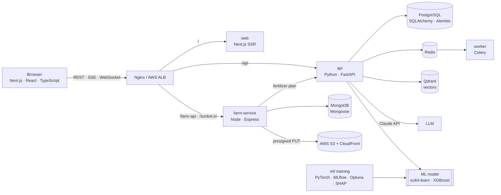

# Agricultural-Production-Optimization
Indian crop fertilizer growth

**AgriOptima** — a full-stack, AI-powered farm platform: crop recommendations from a
trained ML model, fertilizer planning, farm & field management, an AI assistant
(Claude + RAG + LangGraph), batch jobs, real-time updates and AWS deployment.



## Structure

| Folder | What it is | Stack |
|---|---|---|
| [frontend/web](frontend/web) | Web app | Next.js 16, React 19, TypeScript, Tailwind, Sass, shadcn/ui, Material UI, Redux Toolkit, Zustand, Context API, TanStack Query, Axios, React Hook Form, Zod, Framer Motion, Socket.IO client, Vitest, Jest, Playwright |
| [backend](backend) | ML / AI API | Python, FastAPI, Pydantic, SQLAlchemy, Alembic, PostgreSQL/SQLite, JWT + OAuth2 password flow, RBAC, WebSockets, SSE, Celery + Redis, Anthropic SDK (Claude), LangGraph, Qdrant, pytest |
| [services/farm-service](services/farm-service) | Farm management API | Node.js, Express 5, MongoDB + Mongoose (aggregations, `$lookup`, transactions), Zod, JWT, Socket.IO, AWS S3 (SDK v3), helmet, rate limiting, pino, node:test + supertest |
| [ml](ml) | ML pipeline | pandas, scikit-learn, XGBoost, PyTorch, MLflow (tracking + model registry), Optuna, SHAP, matplotlib, pytest |
| [infra](infra) | DevOps | Docker, Docker Compose, Nginx, Terraform (AWS: VPC, ECS Fargate, ALB, RDS, ElastiCache, S3, CloudFront, Secrets Manager, ECR, IAM OIDC) |
| [.github/workflows](.github/workflows) | CI/CD | GitHub Actions: test every service, build images, deploy to AWS |
| [docs](docs) | Documentation | [architecture](docs/architecture.md) · [AWS deployment](docs/deploy-aws.md) · [syllabus coverage](docs/syllabus-coverage.md) |

## Run locally (no Docker)

Needs Python 3.12+, Node 20+, and MongoDB on `localhost:27017` (PostgreSQL optional: SQLite is the default).

```bash
# 1. ML model (once): download the dataset, train and compare models
cd backend && python -m venv .venv && .venv\Scripts\activate    # macOS/Linux: source .venv/bin/activate
pip install -r requirements.txt -r ../ml/requirements.txt
cd .. && python -m ml.data.download_dataset && python -m ml.train

# 2. FastAPI (port 8000, docs at http://localhost:8000/docs)
cd backend && uvicorn app.main:app --reload

# 3. Node farm-service (port 4000)
cd services/farm-service && npm install && npm run dev

# 4. Web app (port 3000)
cd frontend/web && npm install && npm run dev
```

Open http://localhost:3000 and create an account (the first account becomes **admin**).
Set `ANTHROPIC_API_KEY` in `backend/.env` to turn on the Claude-powered assistant;
without it the assistant answers from the knowledge base only. See each folder's
`.env.example` for all settings.

> Port 4000 already taken? Run the farm-service with `PORT=4100` and set
> `NEXT_PUBLIC_FARM_API_URL=http://localhost:4100/api` for the web app.

## Run everything with Docker

```bash
cp .env.example .env          # set JWT_SECRET (32+ chars); optionally ANTHROPIC_API_KEY
docker compose --profile train run --rm trainer   # train the model, logged to MLflow
docker compose up --build     # http://localhost   ·   MLflow UI: http://localhost:5000
```

Compose runs PostgreSQL, MongoDB (replica set), Redis, Qdrant, MLflow, the API,
a Celery worker, the farm-service, the web app and Nginx.

## Tests

| Where | Command | What |
|---|---|---|
| backend | `pytest` | 35 API tests: auth/JWT/RBAC, SQL history & joins, Celery jobs, WebSocket, model serving, RAG, LangGraph agent loop (fake Claude client) |
| ml | `pytest ml/tests` | data validation, every model learns, PyTorch MLP |
| farm-service | `npm test` | 11 integration tests on real MongoDB: ownership, Zod, aggregations, transactions, Socket.IO, S3 presigning, Python service call |
| frontend/web | `npm test` · `npm run test:jest` · `npm run test:e2e` | Vitest (components, stores, SSE parser) · Jest (validation, utils) · Playwright (6 browser flows) |

CI runs all of them on every push, including the backend against real PostgreSQL
and the full ML training run.

## Deploy to AWS

Terraform in [infra/aws/terraform](infra/aws/terraform) creates the whole platform,
and [deploy-aws.yml](.github/workflows/deploy-aws.yml) builds and rolls out images
on every push to `main`. Step-by-step guide: [docs/deploy-aws.md](docs/deploy-aws.md).
