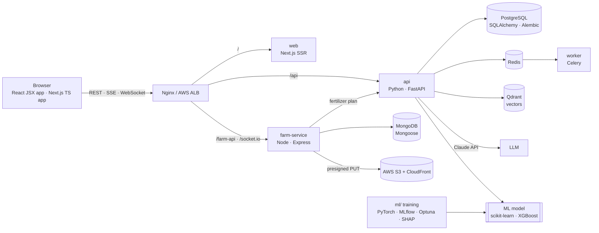

# Agricultural-Production-Optimization
Indian crop fertilizer growth

**AgriSmart** — a full-stack, AI-powered farm platform: crop recommendations from a
trained ML model, fertilizer planning, farm & field management, an AI assistant
(Claude + RAG + LangGraph), batch jobs, real-time updates and AWS deployment.



## Structure

| Folder | What it is | Stack |
|---|---|---|
| [frontend/react-app](frontend/react-app) | Web app in plain **JavaScript (JSX)** | React 19, Vite, React Router, Bootstrap 5 + Sass, Redux Toolkit, Zustand, Context API, TanStack Query, Axios, React Hook Form, Zod, Framer Motion, Socket.IO client, Vitest, Playwright |
| [frontend/web](frontend/web) | Web app in **TypeScript (Next.js)** | Next.js 16, React 19, TypeScript, Tailwind, Sass, shadcn/ui, Material UI, Redux Toolkit, Zustand, Context API, TanStack Query, Axios, React Hook Form, Zod, Framer Motion, Socket.IO client, Vitest, Jest, Playwright |
| [backend](backend) | ML / AI API | Python, FastAPI, Pydantic, SQLAlchemy, Alembic, PostgreSQL/SQLite, JWT + OAuth2 password flow, RBAC, WebSockets, SSE, Celery + Redis, Anthropic SDK (Claude), LangGraph, Qdrant, pytest |
| [services/farm-service](services/farm-service) | Farm management API | Node.js, Express 5, MongoDB + Mongoose (aggregations, `$lookup`, transactions), Zod, JWT, Socket.IO, AWS S3 (SDK v3), helmet, rate limiting, pino, node:test + supertest |
| [ml](ml) | ML pipeline | pandas, scikit-learn, XGBoost, PyTorch, MLflow (tracking + model registry), Optuna, SHAP, matplotlib, pytest |
| [infra](infra) | DevOps | Docker, Docker Compose, Nginx, Terraform (AWS: VPC, ECS Fargate, ALB, RDS, ElastiCache, S3, CloudFront, Secrets Manager, ECR, IAM OIDC) |
| [.github/workflows](.github/workflows) | CI/CD | GitHub Actions: test every service, build images, deploy to AWS |
| [docs](docs) | Documentation | [architecture](docs/architecture.md) · [AWS deployment](docs/deploy-aws.md) · [syllabus coverage](docs/syllabus-coverage.md) |

## Run the complete local stack

Use Python 3.12+, Node 20+, and MongoDB running on `127.0.0.1:27017`. The repo's
`AIML` package is loaded by FastAPI; it is not a separate web server. The script
starts FastAPI, Express, and Vite together, waits for their health endpoints, and
writes service logs under `.devlogs/`.

```powershell
.\scripts\dev.ps1
```

Open the React app at `http://localhost:5175`. FastAPI docs are at
`http://localhost:8000/docs`; Express health is at `http://localhost:4100/health`.
FastAPI issues JWTs and Express validates the same local development secret. The
first account created in an empty local database becomes the admin. Press `Ctrl+C`
in the PowerShell window to stop the services, or run ` .\scripts\stop-dev.ps1`
from another PowerShell window.

The launcher checks the Python environment and installed npm packages. If they are
missing, install them once with:

```powershell
python -m venv backend/.venv
backend/.venv/Scripts/python.exe -m pip install -r backend/python-fastapi/requirements.txt
npm --prefix backend/node-express ci
npm --prefix frontend/react-app ci
```

MongoDB is the only required external service for local farm persistence. If
Docker is installed, `docker compose up --build` starts MongoDB, FastAPI/AIML,
Express, and React together at `http://localhost:8080`. Set `ANTHROPIC_API_KEY`
in `backend/python-fastapi/.env` to enable Claude-backed assistant responses;
without it, the assistant uses the local knowledge base.

## Run everything with Docker

Docker Compose runs MongoDB, FastAPI with the AIML models, Express, and the React
app. The local-only default JWT secret is for development; set `JWT_SECRET` in
`.env` to a random 32+ character value before exposing services beyond your
computer.

```powershell
docker compose up --build
```

Open `http://localhost:8080`. FastAPI docs are at `http://localhost:8000/docs`;
Express is at `http://localhost:4100/health`. Stop with `docker compose down`.

## Tests

| Where | Command | What |
|---|---|---|
| backend | `pytest` | 35 API tests: auth/JWT/RBAC, SQL history & joins, Celery jobs, WebSocket, model serving, RAG, LangGraph agent loop (fake Claude client) |
| ml | `pytest ml/tests` | data validation, every model learns, PyTorch MLP |
| farm-service | `npm test` | 11 integration tests on real MongoDB: ownership, Zod, aggregations, transactions, Socket.IO, S3 presigning, Python service call |
| frontend/web | `npm test` · `npm run test:jest` · `npm run test:e2e` | Vitest (components, stores, SSE parser) · Jest (validation, utils) · Playwright (6 browser flows) |
| frontend/react-app | `npm test` · `npm run test:e2e` | Vitest (19 tests: stores, utils, SSE, form, route guards/RBAC) · Playwright (5 browser flows) |

CI runs all of them on every push, including the backend against real PostgreSQL
and the full ML training run.

## Deploy to AWS

Terraform in [infra/aws/terraform](infra/aws/terraform) creates the whole platform,
and [deploy-aws.yml](.github/workflows/deploy-aws.yml) builds and rolls out images
on every push to `main`. Step-by-step guide: [docs/deploy-aws.md](docs/deploy-aws.md).
